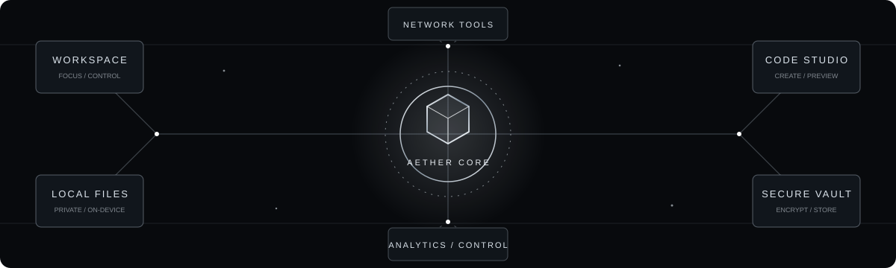

<table>
  <tr>
    <td align="center" width="33%">01 / THINK <strong>Clarity before code</strong></td>
    <td align="center" width="34%">02 / ENGINEER <strong>Systems with purpose</strong></td>
    <td align="center" width="33%">03 / DELIVER <strong>Software that works</strong></td>
  </tr>
</table>

---

## THE ORGANIZATION

**Code Forge** is an independent software development organization focused on turning ambitious ideas into useful, carefully engineered products.

We build software around real needs — from the first system boundary to the smallest interaction. The goal is not to ship noise. It is to create products that feel coherent, dependable, and worth using.

PRODUCT ENGINEERING&nbsp;&nbsp; / &nbsp;&nbsp;SOFTWARE SYSTEMS&nbsp;&nbsp; / &nbsp;&nbsp;OPEN SOURCE

---

## 01 — THE FLAGSHIP

<table>
  <tr>
    <td width="62%" valign="top">

### AETHER

**A DIGITAL OPERATING ENVIRONMENT**

AETHER brings a collection of everyday digital tools into one connected, local-first browser environment. Workspace, files, creation tools, privacy features, and system utilities share one interface instead of living as disconnected utilities.

[OPEN AETHER ↗](https://code-forgehq.github.io/)  
[EXPLORE THE SOURCE ↗](https://github.com/Code-ForgeHQ/Code-ForgeHQ.github.io)

    </td>
    <td width="38%" valign="middle" align="center">
      
    </td>
  </tr>
</table>

  

**AETHER / SYSTEM MODULES**

| MODULE | PURPOSE |
| :--- | :--- |
| Workspace | A unified starting point for everyday work |
| Local files | Browser-based file handling |
| Code studio | Create and preview code |
| Secure vault | Encrypted storage using browser cryptography |
| Network tools | Practical network utilities |
| Command console | A focused command interface |
| Analytics & controls | Visibility and configuration |

BUILT WITH HTML · CSS · JAVASCRIPT · WEB PLATFORM APIS · PWA TECHNOLOGIES

---

## 02 — HOW WE BUILD

<table>
  <tr>
    <td width="50%" valign="top">

**01 / INTENT**

A feature needs a reason to exist. We start with the problem, not a list of trends.

**02 / ARCHITECTURE**

Clear boundaries and predictable behavior make software easier to understand and evolve.

    </td>
    <td width="50%" valign="top">

**03 / CRAFT**

The interface, performance, accessibility, and small details are all part of the product.

**04 / TRUST**

Privacy and security claims must reflect the actual implementation. Limitations should be documented.

    </td>
  </tr>
</table>

---

## 03 — THE WORKBENCH

| LAYER | TOOLS & PRACTICES |
| :--- | :--- |
| **WEB** | HTML · CSS · JavaScript · Browser APIs |
| **APPLICATIONS** | Progressive Web Apps · Service Workers · Responsive UI |
| **SECURITY** | Web Crypto API · PBKDF2 · AES-GCM |
| **ENGINEERING** | Git · GitHub · Accessibility · Maintainable Architecture |

---

## 04 — EXPLORE

<table>
  <tr>
    <td width="50%" valign="top">

**AETHER / LIVE PRODUCT**

The current public product.

[Launch the environment ↗](https://code-forgehq.github.io/)

    </td>
    <td width="50%" valign="top">

**AETHER / SOURCE**

Application code, architecture, and documentation.

[Open the repository ↗](https://github.com/Code-ForgeHQ/Code-ForgeHQ.github.io)

    </td>
  </tr>
  <tr>
    <td width="50%" valign="top">

**ALL REPOSITORIES**

Browse software published by the organization.

[View repositories ↗](https://github.com/orgs/Code-ForgeHQ/repositories)

    </td>
    <td width="50%" valign="top">

**CONTRIBUTE**

Issues, feedback, and thoughtful contributions are welcome.

[Explore the organization ↗](https://github.com/Code-ForgeHQ)

    </td>
  </tr>
</table>

---

### LESS NOISE. BETTER SYSTEMS.

CODE FORGE&nbsp;&nbsp; / &nbsp;&nbsp;DESIGN WITH INTENT · BUILD WITH PRECISION

